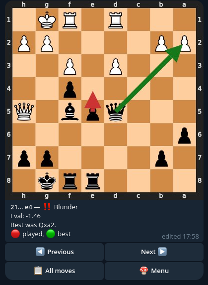

# Chess.com → Telegram game reviewer

A small hobby bot that watches a chess.com account, analyzes new games with
[Stockfish](https://stockfishchess.org/) and sends a move-by-move review to a
Telegram chat.

> **Disclaimer.** This is a general-purpose, approximate analysis. It makes no
> claim to be objective or accurate, and it is **not** a replacement for
> chess.com's Game Review, lichess analysis, or a human coach. Move labels and
> accuracy numbers are produced by a simple model on top of Stockfish and will
> often differ from other tools. This project is unofficial and is not
> affiliated with or endorsed by chess.com, Telegram, or the Stockfish project.


## Features
- Reviews each new game automatically (polls the chess.com public API)
- Board images with arrows: red = played move, green = best move
- Previous / Next buttons, full move list, per-game summary
- Commands: `/last`, `/games`, `/analyze <link or ID>`, `/help`
- English and Ukrainian UI (`BOT_LANG=en|uk`)
- Nothing is written to disk; reviews live in memory only

## Requirements
- Python 3.10+
- Stockfish installed and in your `PATH` (or set `STOCKFISH_PATH`)
- The Cairo library for `cairosvg` (usually preinstalled on Linux; the conda setup below installs it for you)


## Setup
### With conda
```bash
conda env create -f environment.yml
conda activate chess-bot
cp .env.example .env     # fill in the values
python bot.py
```

### With pip / venv
```bash
python -m venv .venv && source .venv/bin/activate
pip install -r requirements.txt
cp .env.example .env     # fill in the values
python bot.py
```

Stockfish is not a Python package. Install it with your system package manager
(or download a binary from stockfishchess.org) and, if it is not in `PATH`, set
`STOCKFISH_PATH` in `.env`.

Create a bot with [@BotFather](https://t.me/BotFather) and set its token as
`BOT_TOKEN` in `.env`. The bot only responds to the numeric Telegram user ID
configured in `TG_ID`.

## Behavior
- On startup, the most recent game is analyzed once. Games already in the
  archive are marked as seen, so a long offline period does not cause a flood
  of messages. Use `/games` and `/analyze <ID>` for older games.
- Reviews are kept in memory (last 50). After a restart, buttons under old
  messages stop working; use `/analyze <ID>` to open a game again.

## How the analysis works
Each position is analyzed once with Stockfish (depth 16 by default). Scores are
converted to win probability using the formula published by lichess, and a move
is classified by the drop in win probability (5 / 10 / 15 points for
inaccuracy / mistake / blunder). Accuracy uses lichess's per-move accuracy
formula. A move that leaves the position clearly winning is not penalized in
its label.

## Limitations
- Chess.com's own classification is closed source and is not reproduced here.
  Numbers follow the open lichess model, so they are similar in spirit but not
  identical.
- "Brilliant" is a heuristic: a near-best move that sacrifices a piece in a
  still-unsettled position. It can miss discovered or complex sacrifices and
  can occasionally fire on ordinary exchanges.
- Analysis depth is limited, so evaluations (especially in sharp positions) can
  change with more depth or a different Stockfish version.
- Explanations are templated (best move, nearby mate warnings), not natural
  language coaching.
- Only games of the configured account can be analyzed. Chess.com can take a
  short while to list a finished game in its archive.
- The bot polls a public API; keep the poll interval reasonable.

## License
This project is licensed under the [MIT License](LICENSE).
Stockfish is a separate GPL-licensed program that this bot runs as an
external process; it is not bundled here.
